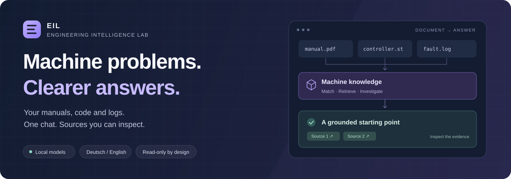
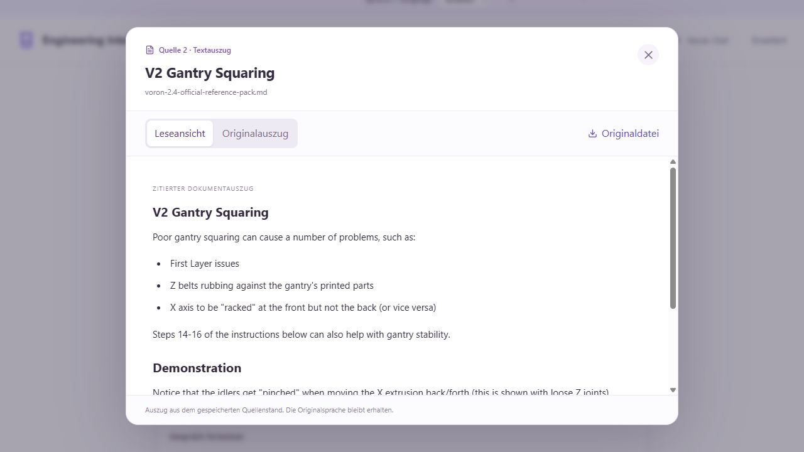
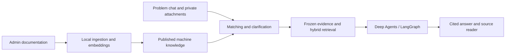

<h1 align="center">Engineering Intelligence Lab</h1>

<p align="center">
  A local-first troubleshooting workspace for the people who keep machines running.<br />
  Describe the problem. Find the relevant evidence. Inspect every source.
</p>

<p align="center">
  <a href="https://github.com/RichiiiTV/engineering-intelligence-lab/actions/workflows/ci.yml"></a>
</p>

<p align="center">
  <a href="#start-locally">Get started</a> ·
  <a href="#from-a-fault-to-the-evidence">See the workflow</a> ·
  <a href="docs/architecture.md">Architecture</a> ·
  <a href="docs/project-review-2026-11-01.md">Project review</a>
</p>

## From a fault to the evidence

EIL connects machine documentation to a simple chat. Administrators add manuals,
code exports and technical references. Local embeddings and a bounded agent
workflow group the material, identify the relevant machine and retrieve passages
for a cited answer. Uncertain machine matches lead to a clarification.

| Prepare the knowledge | Describe the problem | Follow the evidence |
| :--- | :--- | :--- |
| An administrator uploads and publishes machine documentation. | A user writes in German or English and optionally adds a photo or error log. | The answer links to saved passages, original excerpts and document details. |

> **“Mein Voron 2.4 hat Probleme mit der ersten Schicht. Welche Hinweise gibt die Dokumentation zur Gantry-Ausrichtung?”**

No machine picker or source setup is needed in the user flow. Start a new chat for
a new problem; the backbone handles matching, retrieval and conversation context.



<p align="center"><sub>Actual source reader with the licensed Voron corpus. Source text keeps its original language.</sub></p>

## Built around the investigation

| Capability | What it gives you |
| :--- | :--- |
| **A document backbone** | Local hybrid keyword/vector search, machine grouping and frozen source snapshots. |
| **Images, logs and code** | Private problem attachments, local vision transcription and static source inspection. Uploaded code is never executed. |
| **Inspectable answers** | Clickable citations, readable excerpts, provenance and authenticated original downloads. |
| **Deutsch / English** | Switch the interface and new answers while keeping drafts, history and sources intact. |
| **Siemens public references** | Optional read-only MCP lookup for eligible PLC identifiers explicitly typed in the current question. Private attachments and history never supply search terms. Use “nur lokal” / “local only” to opt out. |
| **Workspace controls** | Accounts, roles, revocable sessions, content-minimal audits, backups and explicit catalog publication. |
| **Bounded agent runs** | Cumulative token, step and time limits; durable checkpoints; cancellation; local traces and an Advanced workspace. |
| **Local or HPC inference** | Windows/Linux workbench, Slurm/NVIDIA Ollama modules and an optional native vLLM backend with no Docker requirement for inference. |
| **Visible progress** | Opt-in live investigation stages and clearer ingestion status, with completed answers and citations kept together. |

Published machine knowledge is shared with active workspace accounts. Problem
chats and attachments stay owner-scoped. Models run locally by default; agents
have no host shell, unrestricted network access or equipment-write tools.

## Start locally

You need **Python 3.12+**, **uv**, **Node.js 22.12+ or 24**, and a local **Ollama**
service. Docker Desktop's Linux engine is required only for isolated PDF ingestion.

```powershell
git clone https://github.com/RichiiiTV/engineering-intelligence-lab.git
cd engineering-intelligence-lab
uv sync --locked --extra dev
Copy-Item .env.example .env

ollama pull qwen3.5:4b-q8_0
ollama pull embeddinggemma:300m

Push-Location frontend
npm.cmd ci --ignore-scripts
npm.cmd run build
Pop-Location

uv run --locked uvicorn eil.api:app --host 127.0.0.1 --port 8000 --timeout-graceful-shutdown 5
```

Open **http://127.0.0.1:8000/**. In a second terminal, run
`uv run --locked python -m eil.cli auth-bootstrap` and use its one-time setup code
to create your administrator account. There are no default credentials.

The backend serves the built UI. Keep one API service per state directory, bound
to loopback. The [setup guide](docs/getting-started.md) covers model settings,
PDF conversion, the Windows launcher and development commands.

**Linux or an HPC?** Follow the [Linux and Slurm guide](docs/linux-hpc.md) for the
Bash launcher, site Ollama modules, SSH tunnels and separately installed native
vLLM. Ollama remains the default. Cluster-specific GPU validation is still required.

**Try a real machine corpus:** the pinned [Voron 2.4 reference pack](docs/public-machine-pilot.md)
includes public documentation, controller configuration, attribution and upstream
GPLv3 license notices. Import it through Administration to build a first catalog.

<details>
<summary><strong>Under the hood</strong></summary>



**FastAPI + Pydantic** handle the API and application controls. **Deep Agents /
LangGraph** run bounded investigations through explicit **Ollama** or optional
self-hosted **vLLM** adapters.
**SQLite FTS5 + sqlite-vec** provide retrieval; **DuckDB** supplies deterministic
analytics. The UI uses **React + TypeScript + Vite**. PDF extraction runs in an
isolated **Docling** container.

</details>

## Validation and current limits

EIL is development software with offline acceptance tests, dependency audits and
documented real-model pilots. The [November 2026 review](docs/project-review-2026-11-01.md)
records the current fixes, supply-chain checks and performance findings.
The [performance and HPC follow-up](docs/performance-and-hpc-followup.md) records
measured token rates, cache experiments, current quality checks and Linux support.

The real Voron pilot had two expected behaviors and one controller-question
failure despite relevant retrieved evidence. Fresh M5 runs passed 6/6 checks for
each local quantization; the separate Voron follow-up still failed both controller
cases. Original failures remain recorded, and hosted-model validation is deferred.
A citation identifies a source location,
but does not establish that a claim is correct or compatible with installed hardware.
Machine grouping is heuristic, and image transcriptions are unverified observations.
Human review is required before acting on equipment. Production operation and
autonomous equipment control have not been validated.

## Explore the project

| Build and operate | Understand and evaluate |
| :--- | :--- |
| [Getting started](docs/getting-started.md) | [Architecture](docs/architecture.md) |
| [Linux / Slurm / native vLLM](docs/linux-hpc.md) | [Performance and quality follow-up](docs/performance-and-hpc-followup.md) |
| [Accounts, backups and PDF setup](docs/security-operations.md) | [Chat backbone and machine matching](docs/chat-backbone.md) |
| [Knowledge administration](docs/knowledge-library.md) | [German/English and Siemens routing](docs/german-siemens-routing.md) |
| [Private machine workspaces](docs/machine-workspaces.md) | [M5 evaluation protocol](docs/m5-evaluation.md) · [Results](docs/m5-results.md) |
| [Source reader](docs/source-reader.md) · [Language switching](docs/languages.md) | [M6–M10 results](docs/m6-m10-results.md) |
| [Publication privacy](docs/publication-privacy.md) | [Security and performance review](docs/project-review-2026-11-01.md) |

Committed demo material is generated or explicitly licensed public content.
Third-party license notices apply to their respective sources. Runtime uploads,
private workspaces, accounts, credentials and investigation history stay out of Git.
