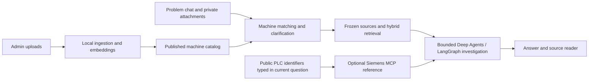

# Engineering Intelligence Lab

**Describe a machine problem. Find the relevant documentation. Investigate with traceable evidence.**

[](https://github.com/RichiiiTV/engineering-intelligence-lab/actions/workflows/ci.yml)


Engineering Intelligence Lab (EIL) is a local-first engineering troubleshooting
prototype. Administrators provide machine manuals, documentation and code exports.
Users describe a problem in chat and optionally attach photos or error logs. A
bounded Deep Agents / LangGraph workflow matches the machine, retrieves relevant
passages and produces an answer with inspectable sources.

The interface and new answers support **Deutsch and English**. Source documents
retain their original language. This project is independent of NodeWeft.

> **Status:** locally validated development software. Citation checks establish
> source locations, not the truth of every generated claim. Real-model evaluations
> include documented failures; EIL is not validated for production operation or
> autonomous equipment control.

[Get started](#get-started-on-windows) · [How it works](#how-it-works) ·
[Documentation](#documentation) · [Validation](#validation-and-known-limits)

## One chat, a document backbone

- **Automatic machine knowledge:** local embeddings and bounded LLM extraction
  group administrator-published material by machine identity. Ambiguous matches
  lead to a clarification in chat.
- **Grounded retrieval:** keyword and SQLite vector retrieval search the frozen
  source snapshot for each answer. Citations open the original passage.
- **Readable sources:** a focused reader formats headings, lists and code, with
  the exact original excerpt, provenance and an authenticated original-file link.
- **Images and logs:** optional problem attachments stay private to their owner.
  Local vision produces an explicitly unverified transcription of image text.
- **Public Siemens references:** eligible PLC diagnostics can trigger the fixed,
  read-only Siemens MCP search from canonical product/error identifiers typed in
  the current question. Private documents, logs, images and history never supply
  outbound query terms. Add “local only” / “nur lokal” to opt out.
- **Controlled investigations:** durable checkpoints, cumulative token/step/time
  budgets, cancellation, source snapshots and local traces make runs inspectable.
- **Administration:** local accounts, roles, revocable sessions, explicit catalog
  publication, backup/retention controls and a content-minimal audit trail.
- **Advanced workspace:** administrators can inspect detailed run activity,
  deterministic inspection-data analysis, exports and human-approved report drafts.


*Actual source reader using the licensed Voron test corpus; German controls and
unchanged English source text. The original excerpt remains available separately.*

## Get started on Windows

### Prerequisites

- Python **3.12+** and `uv`.
- Node.js **22.12+** or **24**, with npm.
- A local Ollama service for model answers and semantic indexing.
- Docker Desktop with the Linux engine **only for PDF ingestion**; plain text,
  Markdown and code exports do not require the PDF worker.

```powershell
git clone https://github.com/RichiiiTV/engineering-intelligence-lab.git
cd engineering-intelligence-lab

uv sync --locked --extra dev
Copy-Item .env.example .env

# In your local Ollama installation:
ollama pull qwen3.5:4b-q8_0
ollama pull embeddinggemma:300m

Push-Location frontend
npm.cmd ci
npm.cmd run build
Pop-Location

uv run --locked uvicorn eil.api:app --host 127.0.0.1 --port 8000 --timeout-graceful-shutdown 5
```

Open **http://127.0.0.1:8000/**. In a second terminal at the repository root:

```powershell
uv run --locked python -m eil.cli auth-bootstrap
```

Use the printed one-time setup code to create your administrator account. Choose
your own password; there are **no default credentials**. API documentation at
http://127.0.0.1:8000/docs requires sign-in too.

The backend serves the built frontend. Only one API worker/service may own a
state directory. Keep the application bound to loopback; network deployment is
outside its validated scope.

### Configure models and PDFs

`.env.example` documents the Ollama URL, generation model, embedding model and
optional local state directory. `.env`, model files, runtime databases, uploaded
material, local reports and dependencies are excluded from Git.
The defaults use [Qwen 3.5 4B Q8_0](https://ollama.com/library/qwen3.5:4b-q8_0)
and [EmbeddingGemma 300M](https://ollama.com/library/embeddinggemma:300m).

For PDF conversion, build the isolated worker and explicitly prefetch the required
Docling assets using the [operator guide](docs/security-operations.md#isolated-pdf-conversion).
The Windows launcher, `scripts\start-workbench.cmd`, builds the UI and runs with
the optional document dependencies; it does not start Ollama or download models.
See the operator guide for the full container setup before uploading PDFs.

## Use it

**Administrator:** open **Administration → Machine knowledge / Maschinenwissen**.
Upload manuals, documentation or code exports and explicitly confirm publication
to active accounts in this workspace. Watch the ingestion progress and inspect
assignment evidence. Archive obsolete or inappropriate sources.

**User:** describe the fault and optionally attach an image or log. The backbone
handles machine matching, retrieval and conversation context. Users do not need
to select machines, notebooks or documents. Open a new chat for a different problem.

Example questions:

> Mein Voron 2.4 hat Probleme mit der ersten Schicht. Welche Symptome nennt die
> Dokumentation für eine schlecht ausgerichtete Gantry? Bitte mit Quellen.

> My machine uses a Siemens S7-1500 and shows diagnostic code 16#80A1.
> What public documentation is available for this code?

Use **Sprache / Language** to switch the interface and the language of new answers.
Existing answers and source text are not rewritten. Open a citation to inspect
its saved passage, original excerpt and document details.

### Included real-machine reference pack

The repository includes a pinned **Voron 2.4** public reference pack: official
product information, V2 Gantry Squaring documentation and an Octopus controller
configuration. Original snapshots, attribution, hashes and full upstream GPLv3
license notices are retained.

On a new installation, import the combined Markdown file through the administrator
workflow; the existing local workspace's published catalog is not part of Git.
[Import instructions, sources and pilot results](docs/public-machine-pilot.md).
Three generated CC0 reference guides are also bundled as educational fixtures.

## How it works



| Layer | Implementation |
| --- | --- |
| API and application controls | FastAPI, Pydantic, local sessions and owner authorization |
| Agent execution | Deep Agents, LangGraph, explicit Ollama model adapter |
| Knowledge retrieval | Local Ollama embeddings, SQLite FTS5/BM25, sqlite-vec |
| Evidence and run state | SQLite snapshots, checkpoints, durable queue and event stream |
| Deterministic analytics | DuckDB, typed read-only analytical tools |
| Interface | React, TypeScript, Vite |
| Optional PDF extraction | Fixed Docling worker in an isolated container |

Administrator-published knowledge is shared within the workspace. Existing private
machine workspaces are not automatically published; user problem chats and
attachments stay owner-scoped. Source/code contents are untrusted data for static
inspection, never executable instructions. Agents have no host shell, unrestricted
filesystem/network access, PLC writes or user-management tools.

## Validation and known limits

The latest local publication check is recorded in
[GitHub publication review](docs/github-publication.md). CI runs the offline
backend/frontend acceptance checks and dependency advisory checks on pushes.

```powershell
uv sync --locked --extra dev --extra hosted
uv run --locked --extra dev --extra hosted ruff check backend/src/eil tests
uv run --locked --extra dev --extra hosted ruff format --check backend/src/eil tests
uv run --locked --extra dev --extra hosted pytest -q

Push-Location frontend
npm.cmd ci
npm.cmd test
npm.cmd run build
Pop-Location
```

Offline graph tests use scripted models; passing them does **not** establish
real-model diagnostic quality. The real Voron pilot produced two expected
behaviors and one controller-question failure despite relevant retrieved evidence.
Earlier M5 quality failures remain documented. Hosted-model comparison is deferred
and requires explicit provider/model configuration and local operator credentials;
installing the optional adapter does not authorize paid runs.

Machine grouping thresholds are heuristics. A citation is a traceable location,
not a guarantee of claim support, exact hardware compatibility or causality.
Human review remains necessary before applying proposed checks to equipment.
The source reader supports a small safe Markdown subset, with full raw text and
original downloads for complex material.

## Documentation

| Topic | Guide |
| --- | --- |
| Chat, automatic matching and privacy | [Chat backbone](docs/chat-backbone.md) |
| German/English switching | [Languages](docs/languages.md) |
| Source reader and UI acceptance | [Source reader](docs/source-reader.md) |
| Public Siemens query boundary | [German operation and Siemens routing](docs/german-siemens-routing.md) |
| Accounts, sessions, backups and PDF setup | [Local workspace operations](docs/security-operations.md) |
| Library, users and audit trail | [Knowledge administration](docs/knowledge-library.md) |
| Private machine workspaces | [Machine workspaces](docs/machine-workspaces.md) |
| Architecture | [Architecture](docs/architecture.md) |
| Real-machine corpus and failed pilot | [Voron public-machine pilot](docs/public-machine-pilot.md) |
| Evaluation protocol and earlier quality results | [M5 protocol](docs/m5-evaluation.md), [M5 results](docs/m5-results.md) |
| M6–M10 implementation results | [Milestone results](docs/m6-m10-results.md) |
| Security review and remediation | [Project review](docs/project-security-review.md), [Remediation results](docs/gap-remediation-results.md) |

For frontend development, run the backend on port 8000 and `npm.cmd run dev` in
`frontend/`. Vite serves http://127.0.0.1:5173/ and proxies `/api` to the backend.
Rebuild `frontend/dist` and reload the loopback app after frontend changes.

## Data and attribution

Committed demo/evaluation material is generated or explicitly licensed public
content. The Voron reference pack retains its upstream GPLv3 license files and
provenance; generated starter guides carry their declared CC0 notices. Those
third-party notices apply to their respective content. Runtime uploads, private
workspaces, accounts, credentials and investigation history are not distributed
with this repository.
