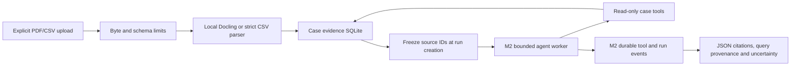

# EIL architecture decision record (ADR-001)

## Mission
An agent-driven investigation system that uses evidence from structured measurements, manuals/PDFs, and authorized tools to answer engineering questions. The first supported scenario is manufacturing false-ejection analysis.

## Boundaries
- `analytics.py`: deterministic analysis and source identification, never LLM arithmetic.
- `agent.py`: optional framework-based tool-using agent. Uses Deep Agents (on LangGraph), not a custom agent loop.
- `api.py`: local FastAPI integration and input validation.
- `runs.py`: transactional SQLite run records, durable queue, event log and budget counters.
- `service.py`: single-owner dispatcher, Windows-spawn worker supervision and process cancellation.
- `execution.py`: standard Deep Agents middleware for budgets/tool audit and LangGraph SQLite checkpoints.
- `evidence.py`: immutable case/source records, strict CSV validation, snapshot-scoped FTS5 retrieval and citation resolution.
- `pdf_ingest.py`: offline CPU Docling conversion in a bounded, supervised process.
- `case_tools.py`, `exports.py`: read-only case evidence tools and auditable JSON reports.
- `uploads.py`: request-size admission before multipart file spooling.
- `data/`: generated synthetic evidence. `ground_truth.json` is eval-only; do not expose to agent.
- `tests/`: reference expectations independent of the model.

## Target architecture (not all implemented)
React UI -> FastAPI -> persistent investigation jobs -> LangGraph workflow -> Deep Agents research/planning -> allowlisted tools (DuckDB, Docling retrieval, MCP) -> evidence store/report.

## Execution/approval policy
M1/M2 analytic tools remain read-only. An explicit Deep Agents `StateBackend` holds virtual state persisted by the thread's `SqliteSaver`, with `FilesystemMiddleware` exposing `ls`, `read_file`, `glob` and `grep`. It does not mount the machine's filesystem. File-writing, deletion, execution and default subagent dispatch are disabled. Offline tests verify tool binding and forged-call rejection. The host application's fixed worker process is not an agent-accessible execution capability. A separate security design, approval policy and sandbox are still required before exposing any execution tool.

## M2 execution

The CLI and HTTP API submit a UUID-scoped job to `runs.sqlite3`. A single background dispatcher
starts one trusted Python worker at a time. The worker constructs the existing Deep Agents
graph with `SqliteSaver` in `checkpoints.sqlite3`, using the generated run ID as its thread ID.
Run limits and model configuration are frozen in the run record, and counters survive resume.
No API field selects a model, thread ID, filesystem path or worker function.

State databases and ownership locks live under `.eil/` or a trusted `EIL_STATE_DIR`. Separate
SQLite exclusive locks prevent two API/CLI services, or overlapping real workers after a
restart, from using the same execution directory. An orphan watcher exits a real worker when
its parent disappears. An active run becomes `interrupted` on shutdown/recovery; queued jobs
remain queued. Recovery resumes pending LangGraph nodes with `None`, never a second user
question. Checkpoint writes use `durability="sync"`.

Pause and cancellation terminate the worker, including blocked synchronous model I/O. Pause
is a development process interruption, not a human-approval LangGraph `interrupt()` prompt.
The last committed checkpoint is recoverable, and an unfinished read-only node can repeat.
Cancellation is final. Model attempts and token reservations are charged before a call, so
restarting or pausing does not refund unknown work. The parent independently monitors total
active time across attempts; paused/queued time does not count.

The event log records status transitions, checkpoint nodes, model usage, requested tools,
arguments, observations and errors. The SSE endpoint replays only the requested run's events
and supports a persisted cursor; it streams run/tool events, not token-by-token model output.
Only controlled errors reach API records. Automatic model summarization is disabled because
its internal model calls would bypass the external run-budget hooks.

## Design trade-offs
- M1 uses standard-library CSV aggregation to keep baseline analysis testable without framework packages. Introduce DuckDB when generalizing query patterns, never raw model-authored SQL against unrestricted stores.
- M2 uses one active worker with up to twenty queued jobs. This is a local development service, with no distributed queue, authentication or retention policy.
- No vector database until document retrieval evaluation justifies one. Start with full-text retrieval and citations.
- Multi-agent only after comparison with a single-agent baseline.

## M3 evidence boundary

Explicit PDF/CSV uploads create generated source UUIDs and SHA-256 hashes under an existing
case UUID. Raw bytes, normalized CSV rows, PDF chunks and provenance live as BLOB/JSON data
in `<state>/data/evidence.sqlite3`. Filenames are display metadata and are never joined to a
host path. Sources are immutable; there are no update/delete endpoints in this milestone.

Case-backed run records freeze `case_id` and `source_ids` at creation. Case tools close over
that snapshot; the model cannot supply another case ID or file path. They replace the legacy
fixture analytics tools, so case runs cannot silently fall back to the global demo dataset.
Later uploads are visible only to new runs. A paused run resumes against its original IDs.

Docling receives a `DocumentStream` of uploaded bytes, supports PDF input only, uses local
prefetched layout/table models on CPU, and disables OCR, remote services and external plugins.
One parser runs at a time with byte/page/chunk/time limits and an orphan-parent watcher.
Item references, offsets, bounding boxes and page numbers are retained. Multi-page elements
retain their full page range rather than falsely attributing the entire item to each page.
The parser process is a lifecycle boundary, not an OS sandbox for hostile native PDF exploits.

Search constructs a bounded, in-memory SQLite FTS5 index from only the frozen source list.
Its BM25 statistics therefore cannot be influenced by another case or later uploads. Query
text is tokenized into literal quoted words; SQL and FTS operators are not accepted from the
model. Each CSV is analyzed independently through the existing deterministic metric function.
Incomplete station periods are reported, not invented or silently included in aggregates.

Exports preserve source hashes, exact query inputs, observed tool outputs and resolvable
PDF/CSV citation IDs. They expand explicit grouped shorthand, flag malformed/unresolved or
unobserved citations, and state when the answer contains no citations. Resolution proves a
source location, not claim entailment or causality. Confidence is not statistically estimated.

Limits do not replace authentication, a native-parser sandbox, retention policy or storage
encryption. Keep the API on loopback and use generated/licensed public demo data. No vector
database, UI, MCP integration or later-milestone feature was added.
