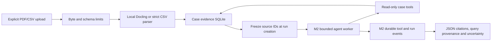

# EIL architecture decision record (ADR-001)

Current implementation update (2026-10-29): authenticated owner-scoped work,
normal-chat Siemens integration and the shared local hybrid knowledge library
supersede the historical milestone limitations below. See
[security operations](security-operations.md), [Siemens chat](siemens-chat.md) and
[knowledge library, user management and audit](knowledge-library.md) for the
current boundaries. Older milestone sections preserve their original decisions.

## Mission
An agent-driven investigation system that uses evidence from structured measurements, manuals/PDFs, and authorized tools to answer engineering questions. The first supported scenario is manufacturing false-ejection analysis.

## Boundaries
- `analytics.py`: deterministic analysis and source identification, never LLM arithmetic.
- `agent.py`: optional framework-based tool-using agent. Uses Deep Agents (on LangGraph), not a custom agent loop.
- `api.py`: local FastAPI integration and input validation.
- `runs.py`: transactional SQLite run records, durable queue, event log and budget counters.
- `service.py`: single-owner dispatcher, Windows-spawn worker supervision and process cancellation.
- `execution.py`: standard Deep Agents middleware for budgets/tool audit and LangGraph SQLite checkpoints.
- `evidence.py`: immutable case/source records, strict CSV validation, snapshot-scoped FTS5 retrieval and citation resolution.
- `pdf_ingest.py`: offline CPU Docling conversion in a bounded, supervised process.
- `case_tools.py`, `exports.py`: read-only case evidence tools and auditable JSON reports.
- `uploads.py`: request-size admission before multipart file spooling.
- `data/`: generated synthetic evidence. `ground_truth.json` is eval-only; do not expose to agent.
- `tests/`: reference expectations independent of the model.

## Target architecture (not all implemented)
React UI -> FastAPI -> persistent investigation jobs -> LangGraph workflow -> Deep Agents research/planning -> allowlisted tools (DuckDB, Docling retrieval, MCP) -> evidence store/report.

## Execution/approval policy
M1/M2 analytic tools remain read-only. An explicit Deep Agents `StateBackend` holds virtual state persisted by the thread's `SqliteSaver`, with `FilesystemMiddleware` exposing `ls`, `read_file`, `glob` and `grep`. It does not mount the machine's filesystem. File-writing, deletion, execution and default subagent dispatch are disabled. Offline tests verify tool binding and forged-call rejection. The host application's fixed worker process is not an agent-accessible execution capability. A separate security design, approval policy and sandbox are still required before exposing any execution tool.

## M2 execution

The CLI and HTTP API submit a UUID-scoped job to `runs.sqlite3`. A single background dispatcher
starts one trusted Python worker at a time. The worker constructs the existing Deep Agents
graph with `SqliteSaver` in `checkpoints.sqlite3`, using the generated run ID as its thread ID.
Run limits and model configuration are frozen in the run record, and counters survive resume.
No API field selects a model, thread ID, filesystem path or worker function.

State databases and ownership locks live under `.eil/` or a trusted `EIL_STATE_DIR`. Separate
SQLite exclusive locks prevent two API/CLI services, or overlapping real workers after a
restart, from using the same execution directory. An orphan watcher exits a real worker when
its parent disappears. An active run becomes `interrupted` on shutdown/recovery; queued jobs
remain queued. Recovery resumes pending LangGraph nodes with `None`, never a second user
question. Checkpoint writes use `durability="sync"`.

Pause and cancellation terminate the worker, including blocked synchronous model I/O. Pause
is a development process interruption, not a human-approval LangGraph `interrupt()` prompt.
The last committed checkpoint is recoverable, and an unfinished read-only node can repeat.
Cancellation is final. Model attempts and token reservations are charged before a call, so
restarting or pausing does not refund unknown work. The parent independently monitors total
active time across attempts; paused/queued time does not count.

The event log records status transitions, checkpoint nodes, model usage, requested tools,
arguments, observations and errors. The SSE endpoint replays only the requested run's events
and supports a persisted cursor; it streams run/tool events, not token-by-token model output.
Only controlled errors reach API records. Automatic model summarization is disabled because
its internal model calls would bypass the external run-budget hooks.

## Design trade-offs
- M1 uses standard-library CSV aggregation to keep baseline analysis testable without framework packages. Introduce DuckDB when generalizing query patterns, never raw model-authored SQL against unrestricted stores.
- M2 uses one active worker with up to twenty queued jobs. This is a local development service, with no distributed queue, authentication or retention policy.
- No vector database until document retrieval evaluation justifies one. Start with full-text retrieval and citations.
- Multi-agent only after comparison with a single-agent baseline.

## M3 evidence boundary

Explicit PDF/CSV uploads create generated source UUIDs and SHA-256 hashes under an existing
case UUID. Raw bytes, normalized CSV rows, PDF chunks and provenance live as BLOB/JSON data
in `<state>/data/evidence.sqlite3`. Filenames are display metadata and are never joined to a
host path. Sources are immutable; there are no update/delete endpoints in this milestone.

Case-backed run records freeze `case_id` and `source_ids` at creation. Case tools close over
that snapshot; the model cannot supply another case ID or file path. They replace the legacy
fixture analytics tools, so case runs cannot silently fall back to the global demo dataset.
Later uploads are visible only to new runs. A paused run resumes against its original IDs.

Docling receives a `DocumentStream` of uploaded bytes, supports PDF input only, uses local
prefetched layout/table models on CPU, and disables OCR, remote services and external plugins.
One parser runs at a time with byte/page/chunk/time limits and an orphan-parent watcher.
Item references, offsets, bounding boxes and page numbers are retained. Multi-page elements
retain their full page range rather than falsely attributing the entire item to each page.
The parser process is a lifecycle boundary, not an OS sandbox for hostile native PDF exploits.

Search constructs a bounded, in-memory SQLite FTS5 index from only the frozen source list.
Its BM25 statistics therefore cannot be influenced by another case or later uploads. Query
text is tokenized into literal quoted words; SQL and FTS operators are not accepted from the
model. Each CSV is analyzed independently through the existing deterministic metric function.
Incomplete station periods are reported, not invented or silently included in aggregates.

Exports preserve source hashes, exact query inputs, observed tool outputs and resolvable
PDF/CSV citation IDs. They expand explicit grouped shorthand, flag malformed/unresolved or
unobserved citations, and state when the answer contains no citations. Resolution proves a
source location, not claim entailment or causality. Confidence is not statistically estimated.

Limits do not replace authentication, a native-parser sandbox, retention policy or storage
encryption. Keep the API on loopback and use generated/licensed public demo data. M3 did not
add vector retrieval. M4's UI and mock integration are described below.

## M4 — local workbench, MCP mock and report approval

The React/TypeScript frontend builds with Vite into `frontend/dist`. FastAPI serves the
index at `/` and hashed assets at `/assets`; API routes retain their normal errors.
Development uses Vite port 5173 with a same-origin `/api` proxy to the loopback API on 8000.
No cloud hosting, CDN scripts, telemetry or third-party fonts are used by the workbench.

The UI selects a case and an investigation by URL parameters. Case changes reset view state;
requests are aborted on unmount. Overview compares an explicitly selected CSV and searches
current PDF evidence. The run view instead uses its frozen M3 snapshot. SSE replays durable
events, deduplicates global event IDs within each run and reconnects from the last cursor.
Run status polling keeps controls current even when the stream has stopped for a pause.
Tool details pair call IDs with arguments and render observations as text. All document,
question and model output is rendered as escaped React text; no generated HTML is executed.

`use_mock_mcp` is opt-in and persisted at run creation. Only case runs may enable it.
The worker adds one reviewed `read_mock_station_context` tool to the existing read-only set.
It uses the official MCP Python SDK 1.x ClientSession/FastMCP initialization, tools/list
and tools/call over in-memory streams, with a three-second deadline. The adapter validates
the tool name, station enum, catalog shape, structured output type and result size. Tool
annotations are never an authorization decision. The fixed local server returns generated
maintenance context; no case evidence, credentials, network URL, subprocess command, resource
roots or host files are supplied. The result is explicitly synthetic and cannot resolve as
a case citation. An external MCP transport is intentionally outside M4.

Report proposals and saved drafts live in separate tables in the run database. Proposal
content is immutable, includes its case/run identity and a SHA-256 of title/body, and starts
pending. A separate approve/reject request must supply the exact digest that was previewed.
An immediate SQLite transaction records the decision, creates at most one approved draft,
and appends its audit event atomically. Repeated identical decisions are idempotent;
stale hashes or conflicting decisions fail with 409. Rejected proposals never create drafts.
Pending proposals and approved drafts survive reload/restart. The agent has no proposal,
decision or save tool. Case creation/uploads are explicit user operations.

This is a local human review workflow, not an authenticated identity or multi-user security
boundary. Unrelated browser origins cannot mutate the API; a self-only CSP applies to the
workbench while the existing Swagger docs keep their normal assets. Keep loopback binding.
M5 evaluation infrastructure, Langfuse, production MCP servers and equipment writes remain
outside this milestone.

## Approved simple user flow

The default React entry now presents files, a question, progress and findings. The former UI
is retained as `AdvancedApp` behind `?view=advanced`. Both modes use the same M4 APIs and
durable state. User-facing source rows/charts are selected from the run export's immutable
source snapshot; model notes are displayed separately from deterministic comparisons.
The new report is a downloadable escaped HTML document, with original evidence metadata
retained for review. It is not an alternative write/approval path. See `simple-user-experience.md`.

## M5 evaluation boundary

`eil.benchmark` is a separate trusted CLI using only the fixed, hash-checked
synthetic benchmark registry. Each row owns a fresh state directory and runs
through the existing Windows process supervisor. `single` is the usual graph;
`delegated` supplies one compiled case-scoped analyst, with no recursive child
or general-purpose agent. Parent and child share the transactional budget and
SQLite saver; child updates are included in the run step count. The existing
workbench API cannot select an experimental provider or delegation mode.

Run middleware adds paired local spans to the existing durable event log.
`tracing.export_trace` returns metadata and measured usage/timing, omitting
prompts, arguments, observations, answers and reasoning. No tracing service or
remote exporter is introduced. Historical/unmatched spans and unknown usage
remain incomplete. Token cost is estimated only from complete recorded usage
and explicitly supplied rates.

The optional hosted extra uses the official OpenAI LangChain adapter only in
the benchmark worker, with explicit model, fixed official endpoint, zero SDK
retries, output cap, input-envelope guard and shared supervised deadline.
Missing configuration is an unrun scorecard slot. Provider quality gates use a
closed synthetic claim contract and observed evidence, not an LLM judge.
Archived run/evidence/trace/score JSON supports deterministic rescoring without
network or SQLite. See `m5-evaluation.md` for the protocol and its limits.

## Public Siemens knowledge boundary

The user authorized Siemens MCP for SPS questions after M5. A separate React
page at `/?page=siemens` posts only its explicitly submitted question to
`/api/knowledge/siemens/search`. It does not read case state, create an agent run,
or add a network tool to the investigation agent. The server connects through
the actual MCP SDK to the fixed public HTTPS endpoint, validates the reviewed
`siemens_search(query)` schema, and rejects any changed contract before dispatch.
It exposes none of the server's URL-fetching, resource, or other search tools.

The transport pins the destination/method, disables redirects/proxies/retries,
requires bounded uncompressed JSON, and enforces a 25-second overall deadline.
There is one search at a time with a two-second minimum interval. Normalized
output contains bounded plain text and up to eight HTTPS Siemens-domain links;
job listings, invalid/unapproved URLs and duplicate links are removed. No linked
page is fetched automatically. The React page independently validates links and
renders text without HTML/Markdown execution. Returned AI summaries are labeled
unverified; results are not inserted into case evidence, stored reports or
automatic prompts. Query/result state remains in page memory.

Loopback Host validation runs before API body admission. Browser-origin checks
cover reads and writes, and cross-site Fetch Metadata is rejected. The existing
upload-size admission now also caps other mutating API bodies at 128 KiB before
JSON parsing. These defenses address browser-to-localhost attacks, not user
identity; authentication, OS isolation and global retention remain open gaps.
